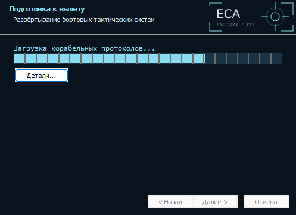

# EVE Combat Assistant

Оверлей для соло-PvP в EVE Online. Сравнивает свой фит с популярными вариантами противника и подсказывает дистанцию, боеприпасы, тип урона, нейтрики и разницу в скорости.

Установщик и portable-архив содержат готовую локальную базу по всем 423 корпусам каталога за 90 полных дней (30.07–27.10.2026). Кнопка обновления актуализирует все корпуса по новым и дополненным дням. Прогресс-бар показывает долю проверенных дней; рядом видны текущая дата, объём загрузки и число добавленных записей. Прерывание или ошибка сохраняют фактический прогресс и причину. Фит выбранного пилота загружается отдельно и появляется выше общих вариантов. Проценты считаются по подходящим потерям кораблей после фильтрации флотов.

 

## Установка

Windows 10/11 x64. [Скачать установщик или portable-архив](https://github.com/Haeniken/eve-combat-assistant/releases/latest). Python, Rust и WSL для запуска не нужны.

1. В шестерёнке открой **Мой корабль** и вставь EFT-фит из EVE/Pyfa.
2. В **EVE SSO** войди персонажем, чтобы загрузить навыки, импланты и доступный фит. Во вкладке **Фит** выбери бустеры и посмотри рекомендации.
3. База уже установлена. В разделе **Данные → Обновить базу всех кораблей** можно актуализировать её перед игрой; выбор цели не запускает загрузку общей статистики.
4. В **Экран** выдели ник в Selected Item справа и полосу ников и названий корпусов на карточках целей слева (звёздочка необязательна). Нажми **Проверить области сейчас**: появятся снимки, текст OCR и найденная цель либо причина ошибки. Затем включи OCR.

Если распознавание сбоит, включи **Экран → Подробная диагностика: OCR, фиты, кеш и HTTP-запросы** и сохрани настройки. Кнопка **Открыть папку диагностики** открывает журналы и снимки выбранных областей. `fits.jsonl` содержит связанные этапы локальной выборки и поиска пилота, SQL, причины фильтрации, HTTP-статусы, задержки, кеш и повторы запросов; токены и полные тела ответов туда не пишутся.

Резисты показаны составной полосой: тёмная часть — база корабля без модулей при навыках V, светлая — прибавка модулей. Под полосой указана база, сверху — итог. Наведение показывает точные значения. «ЕГО УРОН» описывает выбранный пример потери: оружие, дронов и заряды, включая подставленные стандартные заряды. Текущие боеприпасы противника неизвестны; параметры Abyssal-модулей в публичной потере недоступны и отмечаются отдельно.

В **Экран → Хранить исчезнувшую цель** задаётся задержка сброса (по умолчанию 60 секунд, 0 — сразу). При смене цели старые подсказки снимаются сразу; для исчезнувшей цели виден обратный отсчёт.

Фон, непрозрачность окна и масштаб 75–175% настраиваются там же. Рекомендуется оконный режим игры или окно без рамок. `Демонстрация.cmd` показывает пример без сети.

<details>
<summary>Установщик</summary>



</details>

Удаление доступно через «Установленные приложения». Настройки, кеш и базу можно удалить отдельным флажком. Приложение не создаёт служб и заданий планировщика; фоновые потоки завершаются вместе с ним.

## Разработка

Rust, egui/eframe, SQLite и встроенный EVEShipFit dogma-engine. Один процесс, три постоянных рабочих потока; вход и подбор расходников выполняются отдельными короткими задачами. Данные приложения: `%LOCALAPPDATA%\EVECombatAssistant`.

```sh
cargo build --release --locked
cargo fmt -- --check
cargo clippy --locked --all-targets -- -D warnings
cargo test --locked
```

Подготовка базы: `python3 scripts/build_bootstrap.py --prepare-executable target/release/eve-combat-assistant`. Скрипт использует [публичный дневной архив zKillboard](https://zkillboard.com/api/docs/); после подготовки передай каталог с `seed.sqlite3` и `seed-manifest.json` в `package_windows.ps1 -SeedDirectory ...`. База поставляется отдельным файлом `seed/seed.sqlite3`, открывается только для чтения и не заменяет пользовательскую SQLite. Редкие корпуса без подходящих потерь честно показывают пустую выборку.

Для сборки Windows нужны Rust 1.99.1, C++ Build Tools и NSIS 3. Скрипты: `build_windows.ps1` → `package_windows.ps1` → `build_installer.ps1` в папке `scripts/`.

[Архитектура](docs/architecture.md) · [Подробная инструкция и ограничения модели](docs/usage.md) · [Лицензии](THIRD_PARTY_NOTICES.md)
