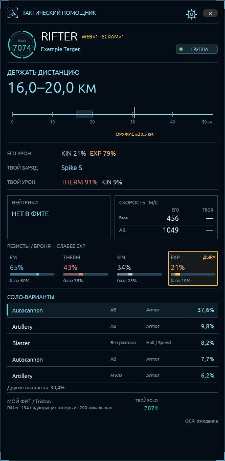
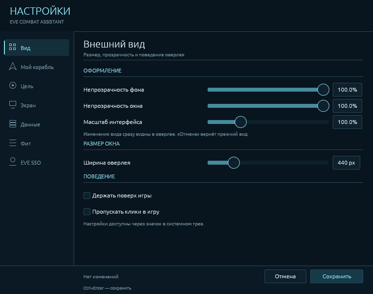

# EVE Combat Assistant

Помощник для соло-PvP в EVE Online. Показывает поверх игры предполагаемый фит выбранного противника, его урон, дальность оружия, скорость и резисты. Сравнивает его с вашим кораблём и предлагает дистанцию боя и заряд из вашего трюма.

Фиты берутся из публичных потерь на zKillboard. Это оценка возможной сборки: фактические модули и заряды встреченного корабля могут отличаться.

 

На снимках — демонстрационные данные. Рейтинг противника показан в кружке, свой SOLO — внизу возле собственного фита.

## Скачать и запустить

**Windows 10/11 x64**, видеодрайвер с OpenGL 3.3 и компонент Windows OCR для выбранного языка. Рекомендуется оконный режим EVE или окно без рамок. Python, Rust и WSL для запуска не нужны.

- [Установщик](https://github.com/Haeniken/eve-combat-assistant/releases/latest/download/EVECombatAssistant-Setup-x64.exe) — обычная установка с ярлыками и удалением через параметры Windows.
- [Portable-архив](https://github.com/Haeniken/eve-combat-assistant/releases/latest/download/EVECombatAssistant-windows-x64.zip) — распакуйте целиком и откройте `eve-combat-assistant.exe` или `Запустить.cmd`.
- [Все версии и список изменений](https://github.com/Haeniken/eve-combat-assistant/releases).

Новую версию можно устанавливать поверх предыдущей: настройки, вход персонажа и пользовательская база сохраняются.

Для знакомства без игры запустите `Демонстрация.cmd` из папки программы. Демонстрация работает без сети и использует отдельные настройки и небольшую выборку фитов.

## Первая настройка

Откройте шестерёнку в верхней части окна.

1. **Мой корабль.** Вставьте EFT-экспорт фита из EVE или Pyfa. Включите оружие, заряды, дронов и боеприпасы в трюме: помощник выбирает заряд из доступных в вашем фите.
2. **EVE SSO.** Войдите своим персонажем, чтобы загрузить навыки и импланты. Пароль вводится на сайте EVE Online. Доступный фит текущего корабля можно взять из ESI; если он неполный, используйте экспорт EFT.
3. **Экран.** Кнопкой **Выделить** задайте две области: ник выбранного пилота в правой панели Selected Item и полосу ников с названиями кораблей на карточках захваченных целей. Захватывайте текст без анимированных колец. Звёздочка после названия необязательна.
4. Нажмите **Проверить сейчас**. Проверьте снимки, распознанный ник и корпус в **Результате проверки**. Затем включите **Распознавать выбранную цель с экрана** и сохраните настройки.
5. **Вид.** Подберите масштаб и прозрачность. При включённом пропуске кликов настройки можно открыть через значок в системном трее.

Готовая база всех корпусов уже входит в установку. Перед игрой её можно актуализировать кнопкой **Данные → Обновить базу всех кораблей**. Загружать общую статистику при каждой встрече не требуется.

Без распознавания экрана корпус и ник можно указать вручную в разделе **Цель**. Подробности настройки — в [руководстве пользователя](docs/usage.md).

## Что видно во время боя

| Блок | Что он показывает |
| --- | --- |
| Цель | Корпус, пилот, расстояние и SOLO-рейтинг по его истории на zKillboard |
| Дистанция | Рекомендуемый диапазон, текущее расстояние и оценочный рубеж оружия противника на линейке |
| Урон и заряд | Типы урона выбранной сборки и рекомендуемый заряд для вашего оружия |
| Нейтрики и скорость | Количество и дальность нейтрализаторов; сравнение базовой скорости и скорости с AB/MWD |
| Резисты | Итог сверху, база корабля снизу; тёмная полоса — база, яркая — прибавка модулей; рамка отмечает дыру |
| Соло-варианты | Популярные сборки из локальной базы и, если найден, отдельный пример фита этого пилота |

Нажмите на другую сборку, чтобы пересчитать показатели для неё. Двойной щелчок открывает полный EFT, правая кнопка — действия с вариантом. Жёлтые SCRAM/WEB/POINT/NEUT/NOS возле названия корабля относятся к выбранной сборке.

Плашки **ГРУППА** и **БЛОБ 10+** описывают историю убийств пилота, а не его текущий флот. Зелёная точка внутри плашки отмечает подтверждённый бой за последние сутки, жёлтая — за последние трое суток. При наведении на точку видно, сколько времени прошло. Свой рейтинг виден возле собственного фита после входа через EVE SSO. SOLO — собственная шкала помощника от 1000 до 8999; при недостатке данных показан прочерк. [Как устроен рейтинг](docs/pilot-rating.md).

## Если что-то не работает

- **Не распознана цель.** В **Экран** повторите проверку двух областей. Ник справа должен читаться целиком, а на карточке цели должны помещаться ник и название корпуса. После перемещения панелей в EVE области нужно выделить заново.
- **Нет сборок.** Обновите базу и проверьте фильтры в **Данные**. У редких корпусов может не быть подходящих потерь даже в полной базе.
- **Неверный собственный фит.** Вставьте свежий EFT. Сведения ESI приходят с задержкой и могут быть неполными; изменения модулей на том же корабле требуют повторного импорта.
- **Нужен разбор ошибки.** Включите **Экран → Подробная диагностика**, сохраните настройки и воспроизведите проблему. Кнопка **Открыть папку** ведёт к журналам и снимкам. [Что записывается и как передать диагностику](docs/usage.md#диагностика).

Системные сведения для разбора запуска автоматически сохраняются в `debug/system.json`. Подробные журналы и снимки по умолчанию выключены.

## Что учитывать

Процент сборки — её доля среди подходящих **потерь**, а не вероятность встретить такой фит у любого живого корабля. Модель боя приближённая; помощь других игроков, активный ремонт и перегрев полностью не моделируются. Для Abyssal-модулей используются стандартные аналоги с предупреждением.

Приложение читает выбранные области экрана и данные API. Управление кораблём остаётся за игроком.

## Документация и исходный код

- [Руководство пользователя](docs/usage.md): все разделы настроек, база, EVE SSO, распознавание и диагностика.
- [Расчёт боевых показателей](docs/fit-metrics.md): дальность, скорость, нейтрализаторы и профили урона.
- [Соло-рейтинг](docs/pilot-rating.md): данные, формула, цветовые уровни и групповые метки.
- [Разработка и сборка](docs/development.md), [архитектура](docs/architecture.md).
- [Лицензии компонентов и игровых данных](THIRD_PARTY_NOTICES.md).

Приложение написано на Rust с egui/eframe, SQLite и встроенным dogma-движком. Настройки и пользовательская база хранятся в `%LOCALAPPDATA%\EVECombatAssistant`.
