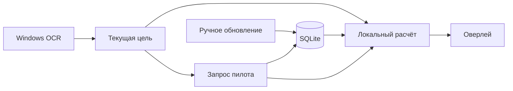

# Как устроено приложение

Один EXE и локальная SQLite. Интерфейс не выполняет HTTP-запросы и расчёты характеристик.

Три постоянных потока:

- **Расчёт** читает локальную выборку, группирует фиты и вызывает dogma. Если в очереди накопились цели, берёт последнюю. Ответы помечаются поколением: запоздавший ответ не заменит новую цель.
- **Сеть** обновляет общую выборку только по команде пользователя. Во время игры обращается за выбранным пилотом. Его killmail не меняют знаменатель общих процентов.
- **OCR** читает панель текущего выбора и, при настройке второй области, карточки захваченных целей. Ник справа сопоставляется с корпусом со звёздочкой слева по координатам OCR-слов. Совпавшие пиксели не распознаются повторно. Смена цели подтверждается двумя наблюдениями, а старая подсказка снимается сразу.

Рисование идёт по событиям. Изменение расстояния не запускает dogma повторно. Группировки кешируются на диске, фиты и сравнения — в памяти. Рабочие потоки Windows имеют пониженный приоритет.

Вход SSO и подбор расходников запускаются по кнопкам как короткие фоновые задачи. Токены не попадают в настройки и SQLite: отдельный файл защищён Windows DPAPI. Расчёты боеприпасов используют один и тот же профиль навыков, имплантов и выбранных бустеров.

## Код

| Файл | Назначение |
|---|---|
| `app.rs` | Состояние цели, сообщения потоков, окна |
| `settings_ui.rs` | Вкладки настроек; редактирует черновик |
| `worker.rs` | Очереди, поколения запросов и кеш сравнений |
| `diagnostics.rs` | Опциональный JSONL OCR, снимки областей и ротация файлов |
| `platform.rs` | GDI capture, WinRT OCR, файловые диалоги |
| `sources.rs`, `store.rs` | ESI/zKillboard, SQLite и HTTP-кеш |
| `fits.rs` | Нормализация killmail, фильтры, группировка, доли |
| `account.rs` | SSO PKCE, проверка JWT и ручной импорт ESI |
| `fit_plan.rs` | Слоты расходников, сравнение имплантов и бустеров |
| `engine.rs`, `tactics.rs` | Dogma и приближённая модель боя |
| `installer/setup.nsi` | Установка, регистрация удаления, выбор очистки базы |

Версия dogma-движка закреплена в `native/vendor/`. SDE и names встроены при сборке; версия и хеши указаны в `native/upstream.json` и `native/data/SHA256SUMS`.

## Сборка

Cargo запускает одно задание, LTO отключено: это снижает пиковую память компиляции и линковки в WSL. На число рабочих потоков приложения эта настройка не влияет.

## Удаление

Установка относится к текущему пользователю. Деинсталлятор закрывает процессы из установленной папки и удаляет файлы, ярлыки и запись в списке приложений. По умолчанию данные остаются. Флажок очистки дополнительно удаляет `%LOCALAPPDATA%\EVECombatAssistant`, включая демонстрационную базу. Папки, заданные вручную через `--data-dir`, автоматически не удаляются.

Отдельных служб, задач планировщика и автозапуска нет. В проверке установщика используются другой идентификатор приложения, отдельная папка и тестовая база.

Ручная проверка отправляется в тот же OCR-поток отдельным запросом `Check(Settings)`; запросы конфигурации не вытесняют её из очереди. UI скрывает окна, выдерживает 450 мс и восстанавливает их после сообщения о завершении захвата, до распознавания. Снимки для предпросмотра остаются в памяти; включённая `ocr_debug` дополнительно сохраняет PNG и JSONL в `debug`. Ошибка автоматического чтения очищает кеш кадров и вызывает повтор, сохраняя включённый OCR.

Выделение области использует отдельный `CaptureDesktop` в OCR-потоке. После скрытия окон UI получает снимок виртуального рабочего стола, загружает его в текстуру и временно разворачивает основное окно без рамки поверх снимка. Координаты выделения переводятся из размеров холста в физические координаты снимка; прозрачный fullscreen не используется. Полный снимок не передаётся в DebugLog. При несовпадении ника OCR отдельно перечитывает его строку с увеличением и контрастом, затем выбирает точное совпадение либо единственное ближайшее имя по ограниченному расстоянию Левенштейна. Геометрия и корпус со звёздочкой проверяются независимо от способа сопоставления.

Перед сопоставлением Selected Item преобразуется в отдельный документ: первая строка имени без бейджа звания, распознанные строки дальности/угловой скорости. Статус безопасности и прочий последующий текст исключаются. При пропуске дальности OCR перечитывает узкую полосу под именем, а согласованные значения переводятся в метры. Исходный документ сохраняется в диагностике рядом с `selected_parsed`; обрезки для повторов остаются в памяти. Корпуса сопоставляются со встроенным каталогом по минимальному ограниченному расстоянию, включая OCR-варианты терминального маркера звезды.
