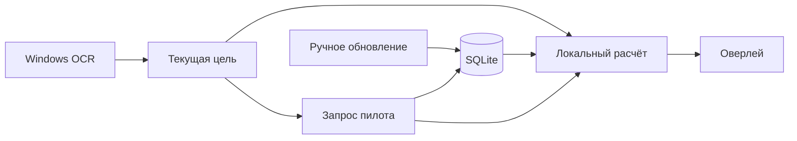

# Как устроено приложение

Один EXE и локальная SQLite. Интерфейс не выполняет HTTP-запросы и расчёты характеристик.

Три постоянных потока:

- **Расчёт** читает локальную выборку, группирует фиты и вызывает dogma. Если в очереди накопились цели, берёт последнюю. Ответы помечаются поколением: запоздавший ответ не заменит новую цель.
- **Сеть** обновляет общую выборку только по команде пользователя. Во время игры обращается за выбранным пилотом. Его killmail не меняют знаменатель общих процентов.
- **OCR** читает небольшой прямоугольник. Совпавшие пиксели не распознаются повторно. Смена цели подтверждается двумя наблюдениями, а старая подсказка снимается сразу.

Рисование идёт по событиям. Изменение расстояния не запускает dogma повторно. Группировки кешируются на диске, фиты и сравнения — в памяти. Рабочие потоки Windows имеют пониженный приоритет.

## Код

| Файл | Назначение |
|---|---|
| `app.rs` | Состояние цели, сообщения потоков, окна |
| `settings_ui.rs` | Вкладки настроек; редактирует черновик |
| `worker.rs` | Очереди, поколения запросов и кеш сравнений |
| `platform.rs` | GDI capture, WinRT OCR, файловые диалоги |
| `sources.rs`, `store.rs` | ESI/zKillboard, SQLite и HTTP-кеш |
| `fits.rs` | Нормализация killmail, фильтры, группировка, доли |
| `engine.rs`, `tactics.rs` | Dogma и приближённая модель боя |
| `installer/setup.nsi` | Установка, регистрация удаления, выбор очистки базы |

Версия dogma-движка закреплена в `native/vendor/`. SDE и names встроены при сборке; версия и хеши указаны в `native/upstream.json` и `native/data/SHA256SUMS`.

## Удаление

Установка относится к текущему пользователю. Деинсталлятор закрывает процессы из установленной папки и удаляет файлы, ярлыки и запись в списке приложений. По умолчанию данные остаются. Флажок очистки дополнительно удаляет `%LOCALAPPDATA%\EVECombatAssistant`, включая демонстрационную базу. Папки, заданные вручную через `--data-dir`, автоматически не удаляются.

Отдельных служб, задач планировщика и автозапуска нет. В проверке установщика используются другой идентификатор приложения, отдельная папка и тестовая база.
