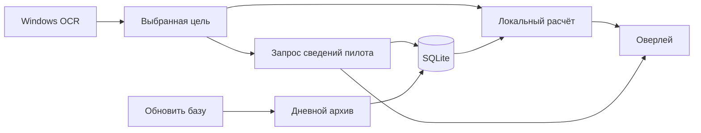

# Архитектура

Один процесс: интерфейс egui/eframe, встроенный dogma-расчётчик, стартовая SQLite рядом с EXE и пользовательская SQLite в каталоге данных. HTTP и расчёты характеристик выполняются вне потока интерфейса.

## Рабочие потоки

Пять постоянных потоков:

- **Расчёт** читает общую локальную выборку и затем добавляет кешированный персональный фит. Стартовая база подключается только для чтения через ATTACH; пользовательские записи объединяются по ID потери. Для стандартных фильтров подготовлены группировки всех корпусов. При других фильтрах они пересчитываются локально. Если накопились запросы целей, обрабатывается последний. Запоздавший ответ не заменяет новую цель благодаря номеру поколения.
- **Обновление базы** работает по команде пользователя: проверяет дни от новых к старым и загружает новые или дополненные архивы. Неизменившиеся дни пропускаются. При обычном обновлении записи, уже находящиеся во встроенной базе, повторно не сохраняются в пользовательскую. Неполная загрузка не получает отметку завершения.
- **Сеть пилотов** загружает сведения выбранного пилота и SOLO-рейтинг собственного персонажа. Эта очередь независима от обновления базы, поэтому медленный дневной архив не задерживает поиск фита. Персональные killmail не меняют знаменатель общих процентов.
- **Быстрый поиск** обслуживает всплывающий поиск по лупе на главной независимо от боевой цели и обновления базы. Рейтинг отправляется в UI до последней PvP-потери. При смене запроса старый отменяется; поколение защищает от запоздавших ответов. HTTP выполняется без повторов, до 8 секунд на запрос и до 25 секунд на этап; кеш ответов — час.
- **OCR** читает Selected Item и карточки захваченных целей. Ник сопоставляется с корпусом по координатам слов и встроенному каталогу. Звёздочка необязательна; повреждённые названия принимаются только при однозначном сопоставлении. Повторное чтение увеличенной строки, контрастный и отфильтрованный варианты помогают при помехах фона. Совпавшие пиксели повторно не распознаются. Смена цели подтверждается наблюдениями, старый совет снимается сразу.

Вход SSO, проверка собственного корабля, подбор расходников и запись системного отчёта используют короткие фоновые задачи. Проверка корабля выполняется раз в минуту; смена конкретного `ship_item_id` запускает обновление профиля. Собственный рейтинг запрашивается раз в час через существующий сетевой поток.

Интерфейс перерисовывается по событиям. Изменение одного расстояния не запускает dogma заново. Группировки кешируются на диске, фиты и сравнения — в памяти. Рабочие потоки Windows имеют пониженный приоритет.

## Захват экрана

Ручная проверка отправляется в OCR-поток отдельным запросом `Check(Settings)` с черновиком настроек. UI скрывает окна, выдерживает 450 мс и восстанавливает их после захвата, до распознавания. Предпросмотры остаются в памяти; подробная диагностика дополнительно сохраняет выбранные области и JSONL. Временная ошибка очищает кеш кадров и вызывает повтор, не выключая OCR.

При выделении области UI получает снимок виртуального рабочего стола и показывает его в окне без рамки. Координаты холста переводятся в физические пиксели снимка. Полный снимок не сохраняется в диагностику. Масштаб и расположение мониторов учитываются при выборе.

Selected Item преобразуется в документ: имя без бейджа звания, строки расстояния и угловой скорости. Статус безопасности исключается. Пропущенная дистанция перечитывается отдельно; противоречивые результаты не принимаются. Ближайший ник допускается только при ограниченном расстоянии Левенштейна и единственном лучшем результате. Геометрия карточки и однозначность корпуса проверяются независимо.

## Код

Все перечисленные Rust-файлы находятся в `rust/`.

| Файл | Назначение |
| --- | --- |
| `app.rs`, `style.rs` | Состояние, основной HUD и общие элементы оформления |
| `settings_ui.rs` | Семь разделов настроек и редактирование черновика |
| `worker.rs` | Очереди, поколения запросов и кеш сравнений |
| `platform.rs`, `ocr.rs` | Windows capture/OCR и сопоставление цели |
| `diagnostics.rs`, `system_info.rs` | Журналы, снимки, ротация и автоматический системный отчёт |
| `sources.rs`, `store.rs`, `seed.rs` | ESI/zKillboard, HTTP-кеш и объединение SQLite |
| `fits.rs` | Нормализация потерь, фильтры, группировка и доли |
| `account.rs` | SSO PKCE, проверка JWT и импорт персонажа из ESI |
| `pilot_lookup.rs` | Поле поиска и отдельное состояние результата, ввод по Enter и Ctrl+V |
| `pilot.rs` | Соло-рейтинг, калибровка и групповые метки |
| `fit_plan.rs` | Импланты, бустеры и подбор расходников |
| `engine.rs`, `tactics.rs`, `fit_metrics.rs` | Dogma, модель боя, дальность, скорость и нейтрализаторы |

Версия dogma-движка закреплена в `native/vendor/`. SDE и names встроены в EXE; версии и хеши указаны в `native/upstream.json` и `native/data/SHA256SUMS`.

## Хранение и установка

Токены не записываются в настройки и SQLite: на Windows отдельный `sso.dat` защищён DPAPI. Краткий `debug/system.json` обновляется при запуске независимо от подробной диагностики. JSONL и PNG включаются только флажком пользователя и ограничены ротацией.

Установщик `installer/setup.nsi` заменяет файлы в папке программы, сохраняя пользовательскую SQLite, настройки и SSO в `%LOCALAPPDATA%\EVECombatAssistant`. Стартовая база рядом с EXE обновляется как часть дистрибутива. Деинсталлятор удаляет пользовательские данные только при выбранном флажке; папки `--data-dir` не затрагивает. Служб, заданий планировщика и автозапуска нет. Тесты установщика используют отдельные идентификатор приложения, каталог и профиль.

[Сборка и проверки](development.md) · [Руководство пользователя](usage.md)
