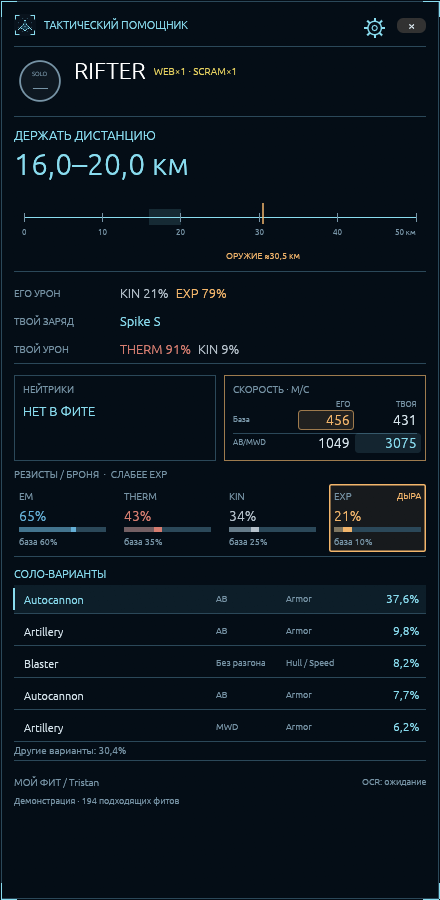
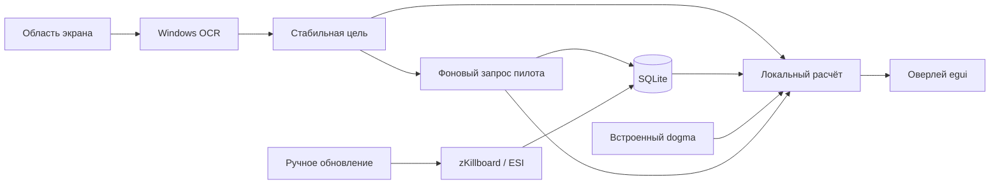

# EVE Combat Assistant

Тактический оверлей для Windows x64. Всё приложение написано на Rust: интерфейс egui/eframe, расчёт характеристик в том же процессе, локальная SQLite. Python и сервер для запуска не нужны. Вход EVE SSO открывает системный браузер.



## Запуск

Распакуй `dist/EVECombatAssistant-windows-x64.zip` в обычную папку Windows и открой `eve-combat-assistant.exe` или `Запустить.cmd`. Для знакомства без настройки запусти `Демонстрация.cmd`: она использует отдельную базу и встроенную небольшую выборку Rifter.

Для работы нужен Windows 10/11 с драйвером OpenGL 3.3 и компонентом распознавания текста Windows для выбранного языка. Установка Python или Rust пользователю не требуется. Предпочтительный режим EVE — оконный или окно без рамок.

1. Открой **шестерёнку → Мой корабль**. Вставь экспорт фита из EVE/Pyfa с зарядами, дронами и боеприпасами в трюме. Можно открыть EFT/TXT. Выбери уровень навыков либо импортируй JSON навыков ESI.
2. В разделе **Цель** выбери корпус. В **Данные** нажми **Обновить статистику сейчас**. Повтори для корпусов, с которыми собираешься драться. Первая загрузка идёт по месяцам и может занимать время; её можно остановить.
3. В **Экран** выдели правую панель Selected Item с ником. Если корпус там не виден, выдели вторую область: полосу ников и названий со звёздочкой на карточках захваченных целей слева. Включи чтение экрана; по умолчанию оно работает только при активном окне EVE.
4. В **Вид** настрой фон, общую непрозрачность, ширину и масштаб 75–175%. При пропуске кликов настройки доступны через значок в системном трее.

Без OCR можно указать корпус и пилота вручную. Для персонального поиска нужен распознанный или введённый ник, одного названия корабля недостаточно. Поддерживаются английские названия корпусов и ники с русскими буквами; распознавание конкретного шрифта и расположения панелей нужно настроить на своей игре.

Главная рекомендация относится к выбранному варианту фита. Нажми другой вариант, чтобы сравнить его. Оверлей показывает диапазон дистанции, действие относительно текущего расстояния, тип входящего урона, доступные боеприпасы, нейтрализаторы, относительную скорость и резисты. Контекстное меню варианта позволяет открыть EFT или исключить его из общей выборки.

## Персонаж и расходники

В **EVE SSO** нажми **Войти через EVE Online**, выбери персонажа и подтверди чтение данных. Client ID уже настроен. Вход использует PKCE; пароль вводится на сайте EVE, Client Secret не нужен. Токены хранятся в `sso.dat`, зашифрованном Windows DPAPI для текущего пользователя. «Выйти» удаляет локальный вход. Выданный доступ можно отозвать в [Authorized Applications](https://community.eveonline.com/support/third-party-applications/).

По кнопке загружаются все доступные навыки, очередь завершённых навыков, импланты активного клона, текущий корпус, сохранённые фиты и assets. Навыки и импланты переносятся в черновик настроек; нажми **Сохранить**. **Обновить персонажа** повторяет загрузку. Во время боя эти запросы автоматически не выполняются.

ESI `/ship` не отдаёт модули. Они восстанавливаются из записей assets с `location_id` текущего корабля. Assets кешируются сервером примерно на час и могут не содержать пилотируемый корабль; если модулей нет, остаётся ручной EFT или выбор сохранённого фита. Сохранённый фит не обязательно совпадает с надетым. Загруженные заряды и состояние активных модулей таким способом полностью не читаются.

В **Мой корабль** работают Ctrl+V и кнопка **Вставить из буфера**. Незагруженные модули получают первый совместимый боеприпас или скрипт из карго EFT. Нехватка CPU/Powergrid показывается при расчёте, но не блокирует импорт.

Во вкладке **Фит** выбери бустеры из карго либо добавь их вручную через поиск. Предмет в карго не считается употреблённым. Активные бустеры отдельным ESI endpoint не читаются; их выбор и выпавшие побочные эффекты задаются вручную. Один слот может содержать один имплант/бустер; новая запись заменяет старую. Импланты надо устанавливать в клона, наличие в трюме бонуса не даёт.

Кнопка **Рассчитать фит и рекомендации** сравнивает небольшой набор обычных PvP-бустеров и имплантов с текущим профилем. Для каждого варианта показывается собственное изменение DPS, скорости, капы, дальности, сигнатуры или применения ракет. Это отдельные альтернативы, а не суммируемые обещания; цены и полный рынок предметов не перебираются. Весь подбор локальный и запускается по кнопке.

## Принудительное обновление

**Шестерёнка → Данные**: выбери период и охват — выбранный корпус цели, все уже загруженные корпуса или все корпуса через дневной архив. Флажок **Принудительно обновить** обходит кеш изменяемых страниц статистики и пересчитывает группировки; записи базы и персональные сведения сохраняются. Полный архив не поставляется вместе с установщиком.

Архив содержит все публичные потери за выбранные дни, до вчерашнего дня включительно; фильтры соло применяются локально. Завершённые дни запоминаются. Если прервать принудительный импорт и повторить его с тем же периодом, он продолжится с контрольных точек. Большой импорт стоит выполнять вне игры.

## Несколько захваченных целей

При двух областях только ник в правой панели определяет текущую цель. OCR находит этот точный ник в левых карточках и читает корпус со звёздочкой ниже в той же колонке, например `Orca*`. Порядок карточек может меняться. Выделяй область текста без анимированных колец; она должна охватывать все возможные позиции карточек.

Без совпадающего ника, звёздочки или при неоднозначном результате подсказка скрывается; предыдущая цель не остаётся на экране. Имя корпуса без звёздочки не подставляется. Если задана только первая область, сохранён прежний режим: ник и корпус должны присутствовать в ней вместе.

## Данные и проценты

Общая выборка охватывает публичные потери нужного корпуса на zKillboard без ограничения по игрокам, регионам и корпорациям. По умолчанию берутся последние 90 дней; можно выбрать другой период или весь архив. В поставке нет предварительно скачанного полного zKillboard. Демонстрация содержит только 200 реальных записей и не представляет всю статистику.

Полные фиты доступны у **потерянных** кораблей. Поэтому процент — доля варианта среди доступных подходящих потерь корпуса после фильтров, а не вероятность встретить такой фит среди всех живых кораблей EVE. Сумма показанных вариантов может быть меньше 100%; остаток отображается отдельно. Новые записи конкретного пилота не меняют общую выборку до ручного обновления.

Мелкие замены модулей объединяются в варианты по оружию, разгону, танку и контролю. Для расчёта берётся наиболее частый полный набор модулей внутри варианта. Заряды и трюм не дробят статистику идентичных модулей. Число вариантов определяется порогом доли, покрытием и максимумом в настройках.

Флотовые записи отсекаются по числу атакующих игроков (по умолчанию один), командным и логистическим модулям, siege/triage и серии одновременных потерь одинакового корпуса одной корпорации в системе. Это консервативный фильтр: публичные killmail не содержат полного состава флота. Дополнительные доктрины можно исключить вручную.

Сведения выбранного пилота загружаются отдельно и кешируются. Недавняя подходящая потеря на том же корпусе добавляется выше общих вариантов, без ожидания сетевого запроса для основного расчёта. В интерфейсе нет дат и дополнительных пометок о происхождении такого фита.

## Проверка экрана и диагностика

В **шестерёнке → Экран** нажми **Проверить области сейчас**. Проверяются координаты и язык из открытого черновика: сохранять фит и включать OCR не требуется. На время захвата окна помощника скрываются, затем возвращаются. Под кнопкой видны оба снимка, исходный текст и найденные пилот/корпус либо точная причина ошибки. После изменения областей проверку нужно повторить.

Для автоматического чтения сохрани настройки и закрой окно настроек. Строка OCR в оверлее показывает работу, паузу вне EVE, выключенное чтение или ошибку с повтором. Временная ошибка не снимает галочку OCR. Правый ник сопоставляется с корпусом со звёздочкой в той же карточке; допускается однозначная ошибка одной буквы в длинном названии и замена `0` на `O`.

Галочка **Расширенное логирование OCR (текст и снимки областей)** по умолчанию выключена. После сохранения она включает подробные журналы автоматического чтения. Для ручной проверки галочка действует сразу, без сохранения. Диагностика находится в `%LOCALAPPDATA%\EVECombatAssistant\debug` либо в `debug` выбранного `--data-dir`; кнопка рядом открывает эту папку.

В `ocr.jsonl` записываются время UTC, версия, координаты, язык, интервал, причины паузы, решения кеша кадров, время обработки, исходный текст и координаты слов, найденный пилот, результат или ошибка. PNG показывают только выбранные области: новые распознаваемые кадры и ручные проверки. Подтверждение и пропуск неизменившегося кадра отмечаются в журнале без повторного снимка. Старые файлы автоматически удаляются: до 80 PNG общим объёмом 64 МиБ, текущий журнал и три предыдущих примерно по 4 МиБ. Выключение галочки прекращает новые записи; сохранённые файлы можно удалить из этой папки. Токены SSO в журнал не попадают.

Если цель не распознана, включи диагностику, сохрани настройки, воспроизведи проблему и сохрани содержимое папки `debug` для разбора. Без расширенного логирования предпросмотр не сохраняет снимки на диск.

## Нагрузка во время игры

- Общая статистика и справочники не обновляются автоматически. Корабли и dogma-данные встроены в EXE; новые данные справочника входят в следующую сборку.
- Фоновая сеть обращается только за сведениями выбранного пилота. Повторные запросы используют кеш, ожидающие запросы устаревших целей объединяются.
- OCR читает только заданный прямоугольник, по умолчанию раз в 1,5 секунды. Одинаковые кадры не распознаются повторно. Вне активной EVE чтение приостанавливается.
- Расчёты, OCR и сеть работают в постоянных фоновых потоках с пониженным приоритетом. Устаревшие ответы не подменяют текущую цель.
- Интерфейс перерисовывается по событиям. Изменение одной дистанции не запускает dogma заново. Группировки сохранены на диск, сравнения и расчёты фитов кешируются в памяти.

Настройки и база: `%LOCALAPPDATA%\EVECombatAssistant`; демонстрация: подпапка `demo`. Для другой папки: `--data-dir "C:\EVEData"`. SQLite следует хранить на локальном диске Windows.

## Модель боя

Dogma-движок учитывает корпус, модули, заряды, навыки, импланты и вручную выбранные бустеры. Поверх него работает компактная модель применения урона: сетка дистанций, резисты, tracking/falloff, ракеты, дроны, webs/scram и отключение MWD, дальность и мощность нейтрализаторов. Боеприпасы выбираются из собственного фита и трюма; для отсутствующих зарядов противника подставляется совместимый стандартный вариант.

Рекомендация — оценка одного столкновения. Модель не воспроизводит полное управление орбитой, активный ремонт по циклам, капбустеры, перегрев и помощь третьих кораблей. Angular velocity по умолчанию не измеряется. Импорт собственного фита нужен повторно после его изменения в игре. Живой сеанс EVE пока не проверен.

## KISS-архитектура



Один EXE, одна SQLite, три постоянных рабочих потока и короткие задачи входа/подбора по кнопкам. `app.rs` — UI и состояние; `worker.rs` — очереди и кеши; `platform.rs` — Windows capture/OCR; `sources.rs` и `store.rs` — данные; `fits.rs` — нормализация и доли; `engine.rs` и `tactics.rs` — характеристики и рекомендации. HTTP нет в потоке UI. Никаких микросервисов, внедрения в процесс игры или управления кораблём.

## Сборка и проверки

Rust 1.99.1, зависимости зафиксированы `Cargo.lock`. Для Windows: Visual Studio Build Tools с C++ toolchain и Windows SDK, затем `powershell -ExecutionPolicy Bypass -File scripts/build_windows.ps1`. Или кросс-сборка из Linux/WSL с MinGW и установленной целью `x86_64-pc-windows-gnu`:

```sh
cargo build --release --locked --target x86_64-pc-windows-gnu
cargo fmt -- --check
cargo clippy --locked --all-targets -- -D warnings
cargo clippy --locked --all-targets --target x86_64-pc-windows-gnu -- -D warnings
cargo test --locked
```

`scripts/windows_smoke.ps1` проверяет native OCR, запуск интерфейса, снимки обоих окон и расход CPU в простое. Из Linux headless можно проверить главный экран через Xvfb и `--demo --screenshot design/overlay-rust.png`; Windows OCR в Linux недоступен.

Дополнительные команды:

```text
eve-combat-assistant.exe --sync --ship Rifter --days 90
eve-combat-assistant.exe --analyze --ship Rifter --fit my-fit.eft
eve-combat-assistant.exe --archive-from 2026-10-01 --archive-to 2026-10-26
```

Обычный импорт корпуса использует месячные страницы API. При достижении лимита страниц приложение сообщает о неполной загрузке. Дневной архив импортируется через меню «Данные» или отдельной командой, сохраняет контрольные точки и может быть продолжен; это большой предварительный импорт, который стоит выполнять вне игры.

Источники: [zKillboard API](https://zkillboard.com/api/docs/), [ESI OpenAPI](https://esi.evetech.net/meta/openapi.json), [EVEShipFit dogma-engine](https://github.com/EVEShipFit/dogma-engine). Движок зафиксирован на v8.1.0, commit `0fc93335555de8e091ef408c45ddb723143d4cfd` (см. `native/upstream.json`); SDE build 3503375, контрольные суммы в `native/data/SHA256SUMS`. Лицензии приложены в `THIRD_PARTY_NOTICES.md` и `native/data/`.

Дизайн: [концепт](../design/overlay-concept.png), [настоящее окно настроек Windows](../design/settings-windows.png), [описание генерации концепта](../design/imagegen-prompts.json). Концепт — иллюстрация; снимки `*-windows.png` получены из работающей программы.
