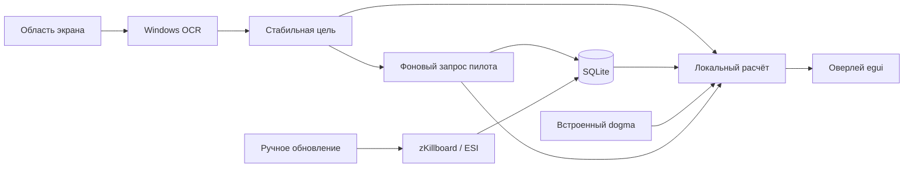

# EVE Combat Assistant

Тактический оверлей для Windows x64. Всё приложение написано на Rust: интерфейс egui/eframe, расчёт характеристик в том же процессе, локальная SQLite. Python и сервер для запуска не нужны. Вход EVE SSO открывает системный браузер.


## Запуск

Распакуй `dist/EVECombatAssistant-windows-x64.zip` в обычную папку Windows и открой `eve-combat-assistant.exe` или `Запустить.cmd`. Для знакомства без настройки запусти `Демонстрация.cmd`: она использует отдельную базу и встроенную небольшую выборку Rifter.

Для работы нужен Windows 10/11 с драйвером OpenGL 3.3 и компонентом распознавания текста Windows для выбранного языка. Установка Python или Rust пользователю не требуется. Предпочтительный режим EVE — оконный или окно без рамок.

1. Открой **шестерёнку → Мой корабль**. Вставь экспорт фита из EVE/Pyfa с зарядами, дронами и боеприпасами в трюме. Можно открыть EFT/TXT. Выбери уровень навыков либо импортируй JSON навыков ESI.
2. Готовая база всех 423 корпусов за 90 дней уже входит в установщик и portable-архив. В **Данные** нажми **Обновить базу всех кораблей**, чтобы актуализировать её перед игрой. Выбор цели работает с локальными данными.
3. В **Экран** выдели правую панель Selected Item с ником. Если корпус там не виден, выдели вторую область: полосу ников и названий со звёздочкой на карточках захваченных целей слева. Включи чтение экрана; по умолчанию оно работает только при активном окне EVE.
4. В **Вид** настрой фон, общую непрозрачность, ширину и масштаб 75–175%. При пропуске кликов настройки доступны через значок в системном трее.

Без OCR можно указать корпус и пилота вручную. Для персонального поиска нужен распознанный или введённый ник, одного названия корабля недостаточно. Поддерживаются английские названия корпусов и ники с русскими буквами; распознавание конкретного шрифта и расположения панелей нужно настроить на своей игре.

Главная рекомендация относится к выбранному варианту фита. Нажми другой вариант, чтобы сравнить его. Оверлей показывает диапазон дистанции, действие относительно текущего расстояния, тип входящего урона, доступные боеприпасы, нейтрализаторы, относительную скорость и резисты. Контекстное меню варианта позволяет открыть EFT или исключить его из общей выборки.

## Персонаж и расходники

В **EVE SSO** нажми **Войти через EVE Online**, выбери персонажа и подтверди чтение данных. Client ID уже настроен. Вход использует PKCE; пароль вводится на сайте EVE, Client Secret не нужен. Токены хранятся в `sso.dat`, зашифрованном Windows DPAPI для текущего пользователя. «Выйти» удаляет локальный вход. Выданный доступ можно отозвать в [Authorized Applications](https://community.eveonline.com/support/third-party-applications/).

По кнопке загружаются все доступные навыки, очередь завершённых навыков, импланты активного клона, текущий корпус, сохранённые фиты и assets. Навыки и импланты переносятся в черновик настроек; нажми **Сохранить**. **Обновить персонажа** повторяет загрузку. Во время боя эти запросы автоматически не выполняются.

ESI `/ship` не отдаёт модули. Они восстанавливаются из записей assets с `location_id` текущего корабля. Assets кешируются сервером примерно на час и могут не содержать пилотируемый корабль; если модулей нет, остаётся ручной EFT или выбор сохранённого фита. Сохранённый фит не обязательно совпадает с надетым. Загруженные заряды и состояние активных модулей таким способом полностью не читаются.

В **Мой корабль** работают Ctrl+V и кнопка **Вставить из буфера**. Незагруженные модули получают первый совместимый боеприпас или скрипт из карго EFT. Нехватка CPU/Powergrid показывается при расчёте, но не блокирует импорт.

Во вкладке **Фит** выбери бустеры из карго либо добавь их вручную через поиск. Предмет в карго не считается употреблённым. Активные бустеры отдельным ESI endpoint не читаются; их выбор и выпавшие побочные эффекты задаются вручную. Один слот может содержать один имплант/бустер; новая запись заменяет старую. Импланты надо устанавливать в клона, наличие в трюме бонуса не даёт.

Кнопка **Рассчитать фит и рекомендации** сравнивает небольшой набор обычных PvP-бустеров и имплантов с текущим профилем. Для каждого варианта показывается собственное изменение DPS, скорости, капы, дальности, сигнатуры или применения ракет. Это отдельные альтернативы, а не суммируемые обещания; цены и полный рынок предметов не перебираются. Весь подбор локальный и запускается по кнопке.

## База и её обновление

**Шестерёнка → Данные → Обновить базу всех кораблей** обновляет весь каталог независимо от выбранной цели. Поставляемый снимок содержит 1 379 032 записи за 30.07–27.10.2026: потери есть у 369 из 423 корпусов. Все корпуса присутствуют в каталоге; отсутствие подходящих потерь не заменяется вымышленными фитами.

Приложение сверяет число записей в дневном архиве и скачивает новые или дополненные дни за выбранный период. Прогресс-бар показывает долю проверенных дней; рядом видны текущая дата, объём загрузки и число добавленных записей. Прерывание или ошибка сохраняют фактический прогресс и причину. Обновления хранятся в `%LOCALAPPDATA%\EVECombatAssistant`, исходный `seed/seed.sqlite3` рядом с EXE открывается только для чтения. Обе базы объединяются по ID потери без повторного подсчёта. Настройки и персональные сведения сохраняются.

Флажок **Повторно скачать весь выбранный период** нужен для полной повторной загрузки; обычно он выключен. Прерванное обычное обновление продолжается при следующем нажатии. Большую повторную загрузку лучше выполнять вне игры.

Сначала показываются популярные варианты из локальной базы, затем независимо ищется фит пилота. Для личного фита подходит последняя доступная PvP-потеря на этом корпусе за заданный срок: ограничение числа атакующих общей соло-выборки к нему не применяется. Сбой поиска пилота не скрывает общие варианты. Пустая выборка отличает отсутствие локальных записей от отсева фильтрами.

Дневной архив содержит публичные ESI-записи, в которых метки zKillboard NPC/awox могут отсутствовать. Фильтры атакующих, флотовых модулей и серий потерь применяются локально; это эвристическая выборка, а не гарантированная классификация каждого боя.

## Несколько захваченных целей

При двух областях только ник в правой панели определяет текущую цель. OCR находит этот точный ник в левых карточках и читает корпус со звёздочкой ниже в той же колонке, например `Orca*`. Порядок карточек может меняться. Выделяй область текста без анимированных колец; она должна охватывать все возможные позиции карточек.

Звёздочка необязательна: без неё принимается полное название или уникальный префикс из каталога, например `Hurricane Fleet` → `Hurricane Fleet Issue`. Переносы названия на следующую строку учитываются в пределах той же карточки. Общий префикс нескольких корпусов, например `Hurricane`, не позволяет выбрать вариант. Если задана только первая область, сохранён прежний режим: ник и корпус должны присутствовать в ней вместе.

Если фон мешает сопоставлению, программа повторно читает карточки: выделяет нейтральный светлый текст, подавляет локальный фон и пробует увеличение. Повторные чтения приводятся к координатам исходной области с учётом наклона текста Windows OCR (TextAngle); угол также записывается в подробный лог. Разные OCR-написания одной карточки объединяются только при совпадении положения и корпуса. Подтверждённый несколькими чтениями ник справа используется для поиска пилота; соседние карточки и разные корпуса не объединяются. Метка объекта без связанной строки корпуса не перехватывает выбор. Короткое обрезанное имя, например `Praxi`, принимается только как уникальный префикс длиной от 5 символов с потерей не более двух последних символов. Остальные неоднозначные случаи отклоняются.

В подробном логе попытки `cards_*` содержат результаты фильтров, координаты кандидатов и подтверждённое исправление ника. Это помогает отличить помехи фона от отсутствующей карточки.

## Данные и проценты

Общая выборка охватывает публичные потери нужного корпуса на zKillboard без ограничения по игрокам, регионам и корпорациям. По умолчанию берутся последние 90 дней; можно выбрать другой период или весь архив. В поставке нет предварительно скачанного полного zKillboard. Демонстрация содержит только 200 реальных записей и не представляет всю статистику.

Полные фиты доступны у **потерянных** кораблей. Поэтому процент — доля варианта среди доступных подходящих потерь корпуса после фильтров, а не вероятность встретить такой фит среди всех живых кораблей EVE. Сумма показанных вариантов может быть меньше 100%; остаток отображается отдельно. Новые записи конкретного пилота не меняют общую выборку до ручного обновления.

Мелкие замены модулей объединяются в варианты по оружию, разгону, танку и контролю. Для расчёта берётся наиболее частый полный набор модулей внутри варианта. Заряды и трюм не дробят статистику идентичных модулей. Число вариантов определяется порогом доли, покрытием и максимумом в настройках.

Флотовые записи отсекаются по числу атакующих игроков (по умолчанию один), командным и логистическим модулям, siege/triage и серии одновременных потерь одинакового корпуса одной корпорации в системе. Это консервативный фильтр: публичные killmail не содержат полного состава флота. Дополнительные доктрины можно исключить вручную.

Сведения выбранного пилота загружаются отдельно и кешируются. Недавняя подходящая потеря на том же корпусе добавляется выше общих вариантов, без ожидания сетевого запроса для основного расчёта. В интерфейсе нет дат и дополнительных пометок о происхождении такого фита.

## Проверка экрана и диагностика

Выделение области показывает снимок рабочего стола с лёгким затемнением. Снимок неподвижен до завершения выбора, хранится только в памяти и освобождается при выборе или Esc. Координаты учитывают масштаб окна и мониторы слева от основного.

В **шестерёнке → Экран** нажми **Проверить области сейчас**. Проверяются координаты и язык из открытого черновика: сохранять фит и включать OCR не требуется. На время захвата окна помощника скрываются, затем возвращаются. Под кнопкой видны оба снимка, исходный текст и найденные пилот/корпус либо точная причина ошибки. После изменения областей проверку нужно повторить.

Для автоматического чтения сохрани настройки и закрой окно настроек. Строка OCR в оверлее показывает работу, паузу вне EVE, выключенное чтение или ошибку с повтором. Временная ошибка не снимает галочку OCR. Если исходный ник не совпал, программа повторно читает увеличенную строку и вариант с усиленным контрастом. Сначала используются точные совпадения и повторы OCR. Если они не помогли, выбирается ближайший ник на карточках: допускаются 1–3 различия в зависимости от длины имени. Среди нескольких результатов выбирается единственный ближайший; равные оценки отклоняются. Даже при одной карточке совершенно другой ник или неоднозначный корпус не принимаются. Метод сопоставления и число различий пишутся в диагностику. Исходный текст и повторы видны в предпросмотре и диагностике. «Объект не выбран» не считается ником.

Правый ник сопоставляется с корпусом со звёздочкой в той же карточке; допускается однозначная ошибка одной буквы в длинном названии и замена `0` на `O`.

Галочка **Подробная диагностика: OCR, фиты, кеш и HTTP-запросы** по умолчанию выключена. После сохранения она включает подробные журналы автоматического чтения. Для ручной проверки галочка действует сразу, без сохранения. Диагностика находится в `%LOCALAPPDATA%\EVECombatAssistant\debug` либо в `debug` выбранного `--data-dir`; кнопка рядом открывает эту папку.

В `ocr.jsonl` записываются время UTC, версия, координаты, язык, интервал, причины паузы, решения кеша кадров, время обработки, исходный текст и координаты слов, найденный пилот, результат или ошибка. PNG показывают только выбранные области: новые распознаваемые кадры и ручные проверки. Подтверждение и пропуск неизменившегося кадра отмечаются в журнале без повторного снимка. Старые файлы автоматически удаляются: до 80 PNG общим объёмом 64 МиБ, текущий журнал и три предыдущих примерно по 4 МиБ. Выключение галочки прекращает новые записи; сохранённые файлы можно удалить из этой папки. Токены SSO в журнал не попадают.

Отдельный `fits.jsonl` связывает по поколениям цели и идентификаторам заданий очередь, локальный анализ, кеш, поиск пилота и HTTP-запросы. Он содержит параметры SQL и время чтения, число исходных/подходящих записей и причины отсева, результаты расчётов, URL без секретных параметров, метод, статус, безопасные заголовки, задержки, повторы и размер/форму ответа. Полные ответы и заголовки авторизации не записываются. Для каждого из OCR и fits сохраняется текущий журнал и три предыдущих по 4 МиБ.

Если цель не распознана, включи диагностику, сохрани настройки, воспроизведи проблему и сохрани содержимое папки `debug` для разбора. Без расширенного логирования предпросмотр не сохраняет снимки на диск.

Ник берётся из первой строки выбранного объекта; необязательное звание после него отделяется по промежутку и размеру шрифта, без списка названий званий. Строка статуса безопасности не считается ником, в том числе при типичных ошибках русского OCR. В диагностике отдельно показаны исходный и очищенный текст.

Дистанция читается справа: `10 км` означает 10000 м, `3 021 м` — 3021 м. Если строка выпала из общего OCR, её участок перечитывается отдельно. Распознанная дистанция отображается в проверке и используется текущими боевыми подсказками после закрытия настроек. Разные результаты повторного чтения не превращаются в случайное значение дальности.

Названия корпусов сверяются со встроенным каталогом всех опубликованных кораблей. После точного имени ищется единственный ближайший вариант с ограничением числа ошибок по длине названия. Распознанные `•`, `·`, `●` в конце строки принимаются как варианты звёздочки; сам корпус должен оставаться привязан к нужной карточке. Например, `Machariet•` сопоставляется с `Machariel`. Каталог не загружается из сети во время боя.

## Резисты, тип урона и исчезновение цели

В каждой колонке резистов сверху показан итог фита, снизу — база корабля без модулей при тех же навыках V. Тёмный участок шкалы соответствует базе, светлый — прибавке модулей того же цвета. Изменение считается в процентных пунктах от базы до итога, с учётом штатного перемножения бонусов и штрафа за стакинг в dogma. Если модули уменьшают резисты, снятый участок отмечается контуром; Polarized обнуляет все резисты. Минимальный итоговый резист выделяется янтарной рамкой и меткой «ДЫРА»; при нескольких равных минимумах выделяются все. При равных итоговых резистах выводится «РАВНОМЕРНО». Если при этом база неравномерна, её минимум отмечается голубой рамкой «БАЗА»: это базовая уязвимость, а не преимущество против итоговой защиты.

«ЕГО УРОН» — потенциальное соотношение типов урона оружия и дронов выбранного примера опубликованной потери, до резистов и применения. В подсказке перечислены оружие и заряды; стандартные совместимые заряды, подставленные при отсутствии исходных, помечены явно. Смартбомбы учитываются только в своей дальности в боевой модели. Проценты не гарантируют состав входящего урона прямо сейчас: противник мог поменять заряд или фит. При наличии Abyssal расчёт продолжается с предупреждением «Присутствуют Abyssal модули, оценка не точна». Публичный killmail не содержит исходного модуля и параметров мутации: используется обычный аналог T2 того же размера. Для семейств без T2 берётся существующий обычный аналог; Small/Medium/Large Abyssal Armor Plates оцениваются как 200/800/1600mm Steel Plates II. Наведение на предупреждение и подробный дебаг перечисляют каждую замену. Показанные доли урона и рекомендации при этом приблизительные. Оригинальный фит сохраняется.

Боеприпасы выбираются из собственного фита и карго по применению урона и итоговым резистам. При равной эффективности на той же дистанции и выровненных итоговых резистах дополнительным критерием служит базовая уязвимость выбранного слоя. Она не подменяет реальное преимущество по урону.

**Экран → Хранить исчезнувшую цель**: по умолчанию 60 секунд, доступно 0–600. Повторные пропуски не перезапускают таймер; повторное появление цели отменяет сброс. Во время удержания видна пометка и обратный отсчёт, дистанция остаётся последней известной. При смене распознанной цели или явно другого ника старые подсказки снимаются сразу. 0 возвращает немедленный сброс. Во время настройки OCR может быть приостановлен.

В кружке рядом с именем корабля показан соло-рейтинг пилота от 1000 до 8999 с шестью цветами. При малой выборке — «—». Рядом с расстоянием показана плашка «БЛОБ 10+» (янтарная) или «ГРУППА» (сине-серая), если в истории преобладают групповые убийства. Она не влияет на соло-рейтинг и не показывает текущий состав флота. У плашки нет всплывающей подсказки. [Формула, интервалы цветов и ограничения](pilot-rating.md). Возраст данных и формула в подсказку не выводятся.

## Нагрузка во время игры

- Общая статистика и справочники не обновляются автоматически. Корабли и dogma-данные встроены в EXE; новые данные справочника входят в следующую сборку.
- Фоновая сеть обращается только за сведениями выбранного пилота. Повторные запросы используют кеш, ожидающие запросы устаревших целей объединяются.
- OCR читает только заданный прямоугольник, по умолчанию раз в 1,5 секунды. Одинаковые кадры не распознаются повторно. Вне активной EVE чтение приостанавливается.
- Расчёты, OCR и сеть работают в постоянных фоновых потоках с пониженным приоритетом. Устаревшие ответы не подменяют текущую цель.
- Интерфейс перерисовывается по событиям. Изменение одной дистанции не запускает dogma заново. Группировки сохранены на диск, сравнения и расчёты фитов кешируются в памяти.

Настройки и база: `%LOCALAPPDATA%\EVECombatAssistant`; демонстрация: подпапка `demo`. Для другой папки: `--data-dir "C:\EVEData"`. SQLite следует хранить на локальном диске Windows.

## Модель боя

Dogma-движок учитывает корпус, модули, заряды, навыки, импланты и вручную выбранные бустеры. Поверх него работает компактная модель применения урона: сетка дистанций, резисты, tracking/falloff, ракеты, дроны, webs/scram и отключение MWD, дальность и мощность нейтрализаторов. Боеприпасы выбираются из собственного фита и трюма; для отсутствующих зарядов противника подставляется совместимый стандартный вариант.

Рекомендация — оценка одного столкновения. Модель не воспроизводит полное управление орбитой, активный ремонт по циклам, капбустеры, перегрев и помощь третьих кораблей. Angular velocity по умолчанию не измеряется. Импорт собственного фита нужен повторно после его изменения в игре. Живой сеанс EVE пока не проверен.

## KISS-архитектура



Один EXE, одна SQLite, три постоянных рабочих потока и короткие задачи входа/подбора по кнопкам. `app.rs` — UI и состояние; `worker.rs` — очереди и кеши; `platform.rs` — Windows capture/OCR; `sources.rs` и `store.rs` — данные; `fits.rs` — нормализация и доли; `engine.rs` и `tactics.rs` — характеристики и рекомендации. HTTP нет в потоке UI. Никаких микросервисов, внедрения в процесс игры или управления кораблём.

## Сборка и проверки

Rust 1.99.1, зависимости зафиксированы `Cargo.lock`. Для Windows: Visual Studio Build Tools с C++ toolchain и Windows SDK, затем `powershell -ExecutionPolicy Bypass -File scripts/build_windows.ps1`. Или кросс-сборка из Linux/WSL с MinGW и установленной целью `x86_64-pc-windows-gnu`:

```sh
cargo build --release --locked --target x86_64-pc-windows-gnu
cargo fmt -- --check
cargo clippy --locked --all-targets -- -D warnings
cargo clippy --locked --all-targets --target x86_64-pc-windows-gnu -- -D warnings
cargo test --locked
```

`scripts/windows_smoke.ps1` проверяет native OCR, запуск интерфейса, снимки обоих окон и расход CPU в простое. Из Linux headless можно проверить главный экран через Xvfb и `--demo --screenshot design/overlay-rust.png`; Windows OCR в Linux недоступен.

Дополнительные команды:

```text
eve-combat-assistant.exe --sync --ship Rifter --days 90
eve-combat-assistant.exe --analyze --ship Rifter --fit my-fit.eft
eve-combat-assistant.exe --archive-from 2026-10-01 --archive-to 2026-10-26
```

Обычный импорт корпуса использует месячные страницы API. При достижении лимита страниц приложение сообщает о неполной загрузке. Дневной архив импортируется через меню «Данные» или отдельной командой, сохраняет контрольные точки и может быть продолжен; это большой предварительный импорт, который стоит выполнять вне игры.

Источники: [zKillboard API](https://zkillboard.com/api/docs/), [ESI OpenAPI](https://esi.evetech.net/meta/openapi.json), [EVEShipFit dogma-engine](https://github.com/EVEShipFit/dogma-engine). Движок зафиксирован на v8.1.0, commit `0fc93335555de8e091ef408c45ddb723143d4cfd` (см. `native/upstream.json`); SDE build 3503375, контрольные суммы в `native/data/SHA256SUMS`. Лицензии приложены в `THIRD_PARTY_NOTICES.md` и `native/data/`.

Дизайн: [концепт](../design/overlay-concept.png), [настоящее окно настроек Windows](../design/settings-windows.png), [описание генерации концепта](../design/imagegen-prompts.json). Концепт — иллюстрация; снимки `*-windows.png` получены из работающей программы.

Если у выбранного примера потери нет определяемого исходящего урона, рекомендации по дистанции и боеприпасам недоступны. Причина показана для этого варианта; рассчитанные резисты и остальные варианты остаются доступны. Подробности сохраняются в диагностике.

Если у строки корпуса пропала звёздочка и OCR исказил буквы, ближайшее название из каталога выбирается только в колонке подтверждённого ника и выше строки расстояния. Неоднозначные варианты, в том числе базовый корпус и его Navy/Fleet-версия, не подставляются автоматически. Короткие повреждённые фрагменты не угадываются.

Импорт ESI получает названия предметов трюма из полного встроенного SDE, включая предметы вне сокращённого боевого каталога. Если старый снимок уже содержит «Неизвестный модуль», нажмите «EVE SSO → Обновить персонажа» и выберите фит текущего корабля заново: в старой строке исходный ID предмета не сохранён. Ошибки проверки собственного фита пишутся в подробный дебаг без текста фита и токенов; для отсутствующего в SDE предмета указан type_id.

«ТВОИ БОЕПРИПАСЫ» показывает только заряды орудий/пусковых установок. Скрипты Tracking Computer, Remote Sensor Dampener и других вспомогательных модулей не являются боеприпасами. Рассматриваются совместимые заряды, уже установленные или имеющиеся в трюме; при отсутствии оружия и наличии дронов выводится «Дроны». Указанные в EFT пустые орудия проверяются с доступными зарядами до отказа расчёта. Диагностика `own_weapons_ready` содержит ID найденного оружия и подходящих зарядов без текста фита.

«ЕГО СКОРОСТЬ» — расчёт выбранного фита противника при навыках V: «База» с выключенными AB/MWD, затем скорость с каждым типом двигателя. Пассивные бонусы модулей и ригов сохраняются. AB и MWD в двойном разгоне считаются отдельно; перегрев и внешние сетки/скрамблеры в этих числах не учитываются. Блок доступен даже без собственного фита или при невозможности рассчитать советы. Значения в м/с.

Обновление персонажа сохраняет уже выбранный собственный EFT, пока персонаж находится на том же конкретном корабле. Взять снимок assets можно отдельной кнопкой; при первом заполнении пустого поля он загружается автоматически. Если в снимке нет пушки, используйте полный экспорт EFT из игры или явно выбранный сохранённый фит. В подробном дебаге ESI записываются маршрут, статус, X-Pages, сроки кеша, число объектов и флаги слотов текущего корабля; токены и полные ответы assets не записываются. Все страницы assets читаются по X-Pages, если заголовок доступен.

Ник на узкой карточке цели может переноситься на две строки. Части объединяются только при точном совпадении с выбранным ником, соседних строках и одной колонке; соседние карточки не объединяются.

Справочник разработчика: [постраничное чтение ESI через X-Pages](https://developers.eveonline.com/docs/services/esi/pagination/x-pages/).

При входе через EVE SSO помощник раз в минуту проверяет текущий корабль. При смене ship_item_id выполняется обычное обновление профиля и фита; пересадка между двумя кораблями одного корпуса тоже считается сменой. Если новый фит недоступен, предыдущий не используется. Проверка работает в фоне при закрытых настройках, без параллельных SSO-запросов; при истечении доступа токен обновляется штатным способом.
